# PPGEEC2327 — Aprendizado de Máquina aplicado à Geofísica

**Discente:** Raphael Ramos da Silva

Exercícios da disciplina, baseados nos laboratórios do curso de *Machine Learning* da Universidade de Utah ([utam.gg.utah.edu](http://utam.gg.utah.edu/Classes/ML/LAB1/)). Cada pasta contém os códigos (MATLAB ou Python) e um notebook com a discussão dos resultados.

| Exercício | Tema | Notebook |
|---|---|---|
| [1](#exercício-1--caps-2-e-3-otimizadores-na-função-de-rosenbrock) | Otimizadores na função de Rosenbrock | [Exercicio 1 - caps 2 e 3](Exercicio1-caps2-3/Exercicio%201%20-%20caps%202%20e%203.ipynb) |
| [2](#exercício-2--cap-4-redes-neurais-totalmente-conectadas) | Redes neurais totalmente conectadas (FCNN) | [Exercicio2_cap4](Exercicio2-cap4/Exercicio2_cap4_Raphael_Ramos.ipynb) |
| [3](#exercício-3--caps-5-a-7-filtragem-de-ruídos-de-migração-fcnn-vs-svm) | Filtragem de ruídos de migração: FCNN vs. SVM | [Exercicio3_cap57](Exercicio3-caps5-7/Exercicio3_cap57_Raphael_Ramos.ipynb) |
| [4](#exercício-4--caps-8-e-9-cnn-para-detecção-de-trincas) | CNN para detecção de trincas em afloramentos | [Exercicio4_caps8_9](Exercicio4-caps8-9/Exercicio4_caps8_9_Raphael_Ramos.ipynb) |
| [5](#exercício-5--cap-12-redes-neurais-recorrentes) | Redes neurais recorrentes (RNN e LSTM) | [Exercicio5_cap12](Exercicio5-cap12/Exercicio5_cap12_Raphael_Ramos.ipynb) |
| [6](#exercício-6--sparse-coding-convolucional) | *Sparse coding* convolucional (CSC) | [Exercicio6](Exercicio6/Exercicio6_Raphael_Ramos.ipynb) |

---

## Exercício 1 — Caps. 2 e 3: Otimizadores na função de Rosenbrock

Comparação de três otimizadores, implementados em Python, na minimização da função de Rosenbrock, cujo mínimo global em (1, 1) fica num vale estreito e quase plano cercado por paredes íngremes:

- **Método de Newton:** usa a Hessiana para ajustar direção e tamanho do passo e converge em poucas iterações, mesmo partindo longe do mínimo.
- **Adagrad:** o acúmulo dos gradientes amortece os passos, exigindo dezenas de milhares de iterações; aumentar α acelera a convergência.
- **Adam:** análise do efeito de β₁, β₂ e α sobre a trajetória e a velocidade de convergência.

  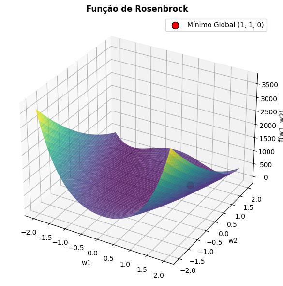
  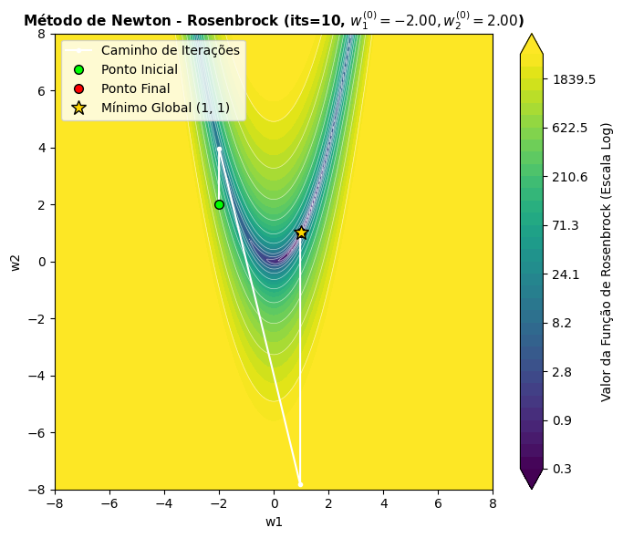
  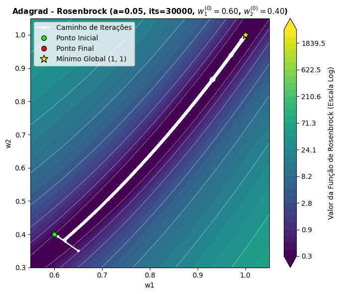
  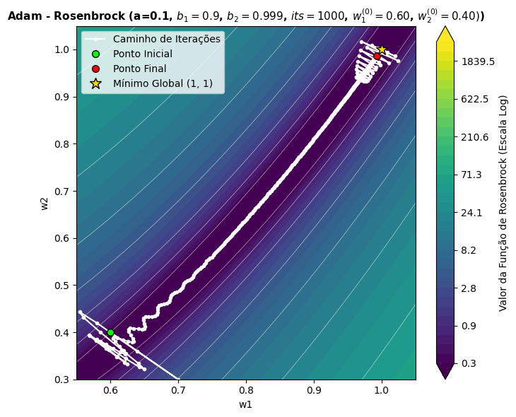

## Exercício 2 — Cap. 4: Redes neurais totalmente conectadas

Implementação e análise de redes *feed-forward* treinadas por gradiente descendente:

- **Classificação binária** (`NNode1.m`): reprodução das Figuras 4.13, 4.15, 4.17 e 4.18 do livro, variando a arquitetura da rede.
- **Validação do gradiente** (`NNode_test.m`): comparação entre o gradiente analítico (*backpropagation*) e o numérico por diferenças finitas (Figura 4.26).
- **Classificação multiclasse** (`NNode_multiclass.m`): Exemplo 4.4.2, comparando ativações sigmoide e ReLU e diferentes profundidades.

  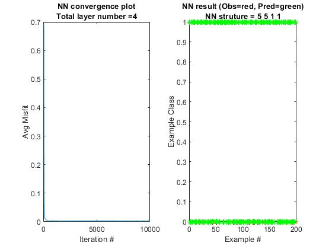
  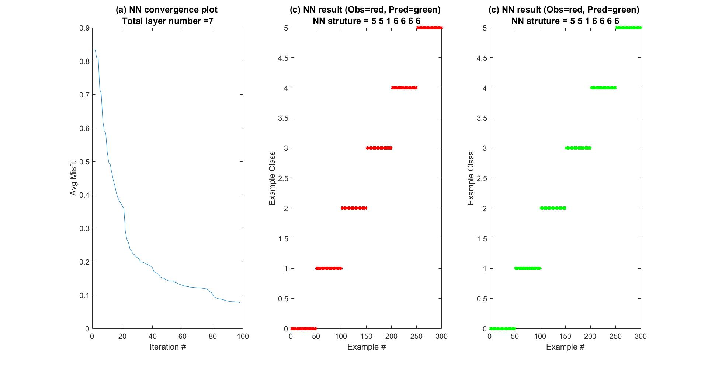

## Exercício 3 — Caps. 5 a 7: Filtragem de ruídos de migração (FCNN vs. SVM)

Comparação entre uma FCNN e uma SVM com kernel RBF na classificação de pontos de uma imagem de migração sísmica em **refletores** ou **artefatos** (arcos de difração). A máscara obtida é usada para filtrar a migração. Foram testados conjuntos de treino desbalanceados (3 refletores vs. 50 artefatos) e o uso de atributos de janela em torno de cada ponto.

  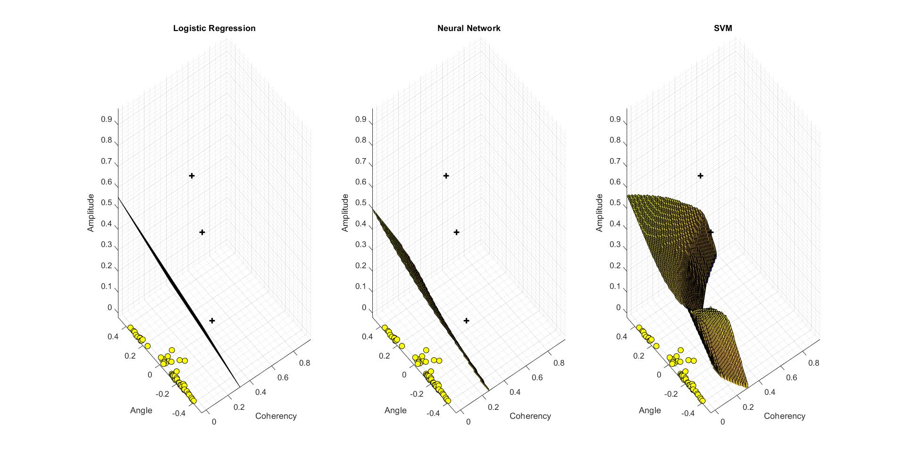
  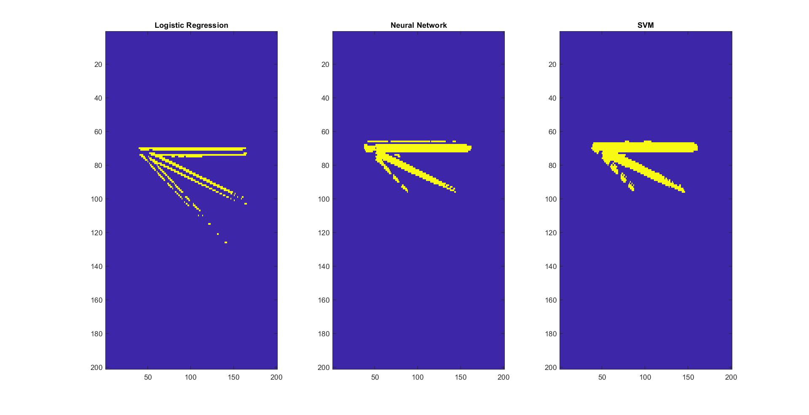

## Exercício 4 — Caps. 8 e 9: CNN para detecção de trincas

Classificação de trincas em fotos de afloramentos geológicos com redes convolucionais. Foram explorados a escolha manual do conjunto de treino, alterações na arquitetura da CNN, o efeito do número de épocas (o "colapso" da rede com 10 épocas e sua recuperação com 100) e a classificação multiclasse (`big_crack`, `small_crack` e `background`).

  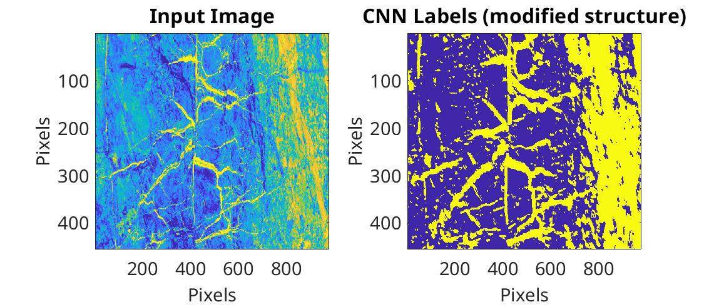
  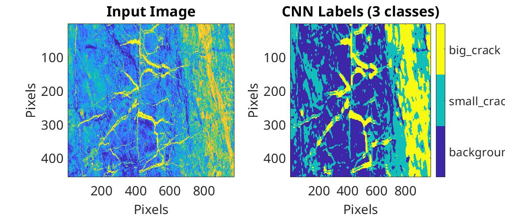

## Exercício 5 — Cap. 12: Redes neurais recorrentes

Uso de RNNs para problemas de séries temporais em sísmica:

1. **Convolução** (`RNN_deconv.m`): a rede aprende a mapear refletividade → sismograma.
2. **Deconvolução** (`RNN_deconv2.m`): mapeamento inverso, comparando uma e duas camadas ocultas.
3. **LSTM** (`RNN_binary_lstm.m`): soma binária, ilustrando como a célula de memória lida com dependências longas ("vai um").

  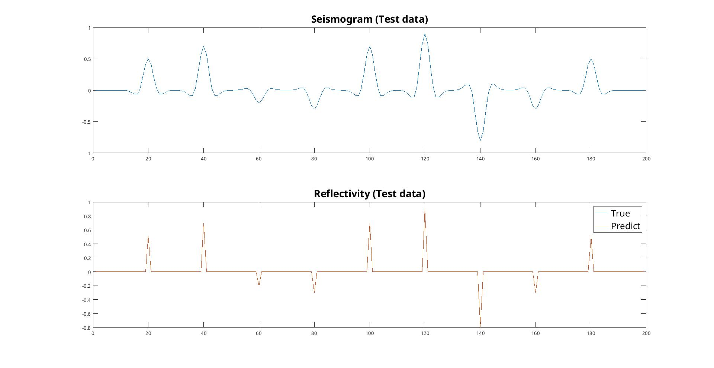
  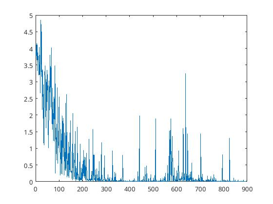

## Exercício 6 — *Sparse coding* convolucional

Remoção de ruído de um sismograma com *convolutional sparse coding* (CSC), resolvido por ADMM. Foram avaliados o tamanho e o número de filtros do dicionário e o peso β da norma ℓ1, medindo a SNR do resultado. Por fim, os filtros aprendidos pelo CSC foram comparados aos da primeira camada de uma CNN treinada no mesmo dado.

  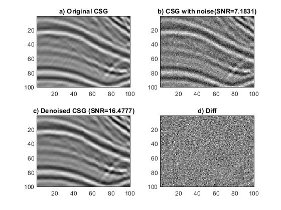
  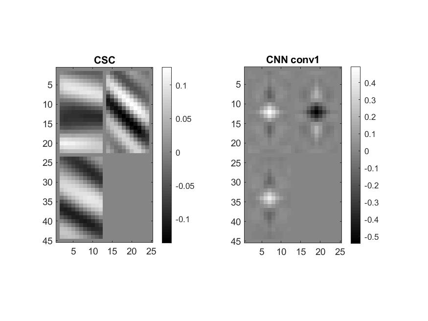

---

### Execução

O Exercício 1 é um notebook Python autocontido. Os demais foram escritos para MATLAB: basta abrir a pasta do exercício e executar o script principal indicado na seção correspondente; os notebooks (`.ipynb`) trazem os resultados já executados e a discussão.
